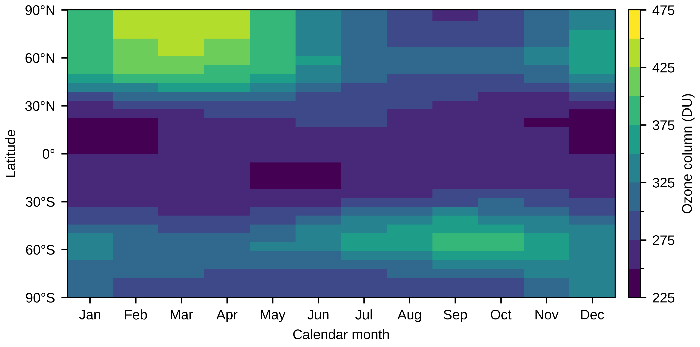

# Historical CO₂ and ozone forcing, 1850–2014

Three experiments compare annual global near-surface air temperature under changing CO₂ and ozone. They follow the [maintainer's five requests](https://github.com/sunmoumou1/PlaSiC/pull/9#issuecomment-7079546681) and use the grid, ocean and warm initial condition from the [reference historical experiment](../historical_3d_500y/).

| Experiment | CO₂ | Ozone |
|---|---|---|
| CO₂ + ozone | Historical UoM monthly concentrations | Historical UReading monthly fields |
| Ozone only | Fixed at 284.316853 ppmv | Historical UReading monthly fields |
| CO₂ only | Historical UoM monthly concentrations | Repeating external 1850 seasonal cycle |

All three start from `icA.restart`, spun up with idealized ozone. The common switch to external ozone can cause adjustment. Each configuration has one member. Own-series baselines remove a mean offset, but do not identify forced trends separately from initial adjustment, model drift or internal variability. The three trajectories describe the model under these configurations.

## Forcing data

The four original `vmro3` files are from CMIP6 input4MIPs, UReading-CCMI-1-0, native grid `gn`, version `v20160711`. They cover 1850–1899, 1900–1949, 1950–1999 and 2000–2014. Together they contain 1,980 monthly fields on 66 pressure levels and a 96 × 144 horizontal grid, totalling 5,927,876,651 bytes. SHA256 values in [SHA256SUMS](SHA256SUMS) match the ORNL and Argonne catalogue replicas. [Dataset identifier](https://hdl.handle.net/21.14100/ab27892c-eaa5-3430-a3c5-f9b0549a556f) · [ESGF search requested by the maintainer](https://github.com/sunmoumou1/PlaSiC/pull/9#issuecomment-7089574072)

## Reproduce the three experiments

Run from the repository root. The pipeline verifies the four ESGF checksums, builds T21/L10 with a 16-level ocean and two MPI ranks, prepares the common pressure climatology, checks the converted ozone columns, integrates the three cases and writes their annual temperature CSV, summary and figures. It uses Python 3.10 or later with NumPy, SciPy, netCDF4 and Matplotlib, plus curl and the [model build dependencies](../../INSTALL.md).

```bash
python experiments/ozone_historical/run_pipeline.py --jobs 2
```

The default download and output directories are `experiments/ozone_historical/data` and `experiments/ozone_historical/runs`. Use `--data` and `--output` to choose another disk. `--model` reuses an existing two-rank executable. `--reference-ps` reuses an existing twelve-month pressure file. The default pressure reference is the first Gregorian year from `icA.restart` with idealized ozone, fixed 1850 CO₂ and 32 steps per day. All three historical experiments reuse this monthly pressure climatology.

The individual stages can also be run separately. The [converter](prepare_ozone.py) takes the four UReading files, `--reference-ps` and `--output`. Add `--fixed-1850` for the repeating seasonal cycle. The [experiment runner](run_experiments.py) accepts `--historical-ozone` and `--fixed-ozone`. The [temperature analysis](fig1/compute_temperature.py) and [plot](fig1/plot_temperature.py) read completed runs from `PLASIC_OZONE_RUNS`.

The launcher can be replaced in full, for example with `--mpirun 'srun -n 2'` under an appropriate Slurm allocation. Each case takes 1,928,480 steps. To exercise a short run with the experiment runner, set `--end-year 1850`. To continue it, rerun with the same input files and output directory. Each completed year is atomically published at `<case>/<year>/` with its restart, monthly NetCDF files and provenance manifest. The current format checks the SHA256 of the restart and every monthly output on resume. Older manifests verify the restart and temperature file. An incomplete or changed checkpoint stops the run.

## Forcing validation

The source-grid and model-grid monthly ozone columns cover every input anchor from January 1850 through December 2014. The source-grid mean integrates the 66 pressure cells to the reference surface pressure interpolated onto the original grid, weighted by the areas of the source cells. A second calculation first samples the source profiles at the target coordinates, then integrates their original pressure cells to the exact target reference pressure. The target uses the stored model layer means and Gaussian area weights. All three columns use standard gravity and the model ozone density at STP. [Monthly columns (CSV)](fig2/results/monthly_columns.csv) · [Column calculation](fig2/compute_columns.py)

The global model column spans 278.231–306.741 DU. Its difference from the original-grid mean ranges from −0.01839 to +0.02004 DU. At matched horizontal positions and pressure the maximum difference over all 4,055,040 grid columns is 0.00002174 DU, including float32 storage.



The figure averages the prescribed column over longitudes and over the 165 occurrences of each calendar month. The ozone column peaks in northern spring at high latitudes. [Zonal climatology (CSV)](fig2/results/zonal_seasonal_cycle.csv) · [Vector figure (PDF)](fig2/results/zonal_seasonal_cycle.pdf)

## Remapping and interpretation

- Source values are ozone mole fractions. The model converts mole to mass fraction using 47.9982/28.9644 for ozone/dry air. Latitude/longitude interpolation is bilinear and periodic in longitude. Vertically each pressure cell contributes in proportion to its overlap with the target layer. Use the deepest source value between the bottom source edge and local ground where necessary.
- Model interfaces use the same monthly reference surface pressure in every year. This conserves the vertical column on that reference pressure grid. The radiation calculation uses the model's instantaneous pressure. The converter reads the Gaussian horizontal grid from the pressure file. Set `--levels` to match atmospheric builds other than L10.
- Both external files use identical time interpolation. January 1850 holds its first value before mid-month, and December 2014 holds its last value after mid-month. In other months the model interpolates between adjacent monthly centres. The interpolated field generally has a different calendar-month average from its input anchor. The fixed file repeats the twelve 1850 monthly fields throughout. This retains the spatial and seasonal structure of the common initial ozone forcing. Reading separately lists a CMIP6 control ozone product. [CMIP6 provider catalogue](https://blogs.reading.ac.uk/ccmi/forcing-databases-in-support-of-cmip6/)
- In 60 sampled months, changing from bilinear to area-conservative horizontal remapping changed the global column by at most 0.018 DU and individual cells by up to 3.70 DU. Substituting the 1850–1859 monthly pressure climatology from the CO₂-only experiment changed global columns by up to 0.080 DU and individual cells by up to 6.30 DU. These are offline sensitivities, with both methods evaluated at a common pressure in each comparison.
- The L10 top layer contains 74.6–81.0% of the global ozone column over the 1,980 months. In the sampled months, using layer-midpoint pressure in the longwave calculation overestimates the top-layer pressure-weighted ozone path by 43–48% and the full-column path by 11–15%. These percentages describe the optical-path approximation. They do not quantify the resulting flux or temperature errors.
- The 1851–1860 mean top-of-atmosphere net downward radiation and full-depth ocean heat storage have opposite signs in all three runs. Their differences are approximately +3.99, +4.72 and +4.03 W m⁻² for CO₂ + ozone, ozone only and CO₂ only. A matched one-year reference with idealized ozone also showed this sign difference. This partial budget excludes other reservoirs.

## Instantaneous radiation diagnostic

At the first radiation call on 1 January 1850 at 00:00, three ozone substitutions use the same `icA` meteorology, CO₂, solar geometry and cloud fields. The January 2014 field is evaluated on this same 1850 clock. Global means use Gaussian area weights, with positive flux downward at the top of the atmosphere. All other kernel inputs were checked for byte equality across substitutions on both MPI ranks.

| Ozone substitution | Net shortwave change (W m⁻²) | Net longwave change (W m⁻²) | Net change (W m⁻²) |
|---|---:|---:|---:|
| January 1850 external minus model idealized | −0.1643 | −0.9359 | −1.1002 |
| January 2014 external minus January 1850 external | −0.0627 | +0.0933 | +0.0306 |

A separate offline longwave calculation integrates the first pressure moment of ozone across the published source cells within each L10 layer. It replaces the midpoint approximation only for the longwave ozone path, holding other radiation inputs fixed. Correcting the top layer alone reduces net downward longwave flux by 0.5307 W m⁻² in the 1850 snapshot and 0.4992 W m⁻² for the 2014 field. Correcting all layers gives a 2014-minus-1850 longwave difference of +0.1297 W m⁻² and a net difference of +0.0670 W m⁻². This diagnostic quantifies one vertical approximation in one atmospheric state. The 165-year coupled experiments use the standard L10 radiation scheme.

These instantaneous differences cannot identify a tropospheric or stratospheric contribution to the temperature trends. Checa-Garcia et al. report +0.30 ± 0.17 W m⁻² for a different diagnostic using 1850–1859 and 2010–2014 climatologies, 60 vertical levels and stratospheric temperature adjustment. [Checa-Garcia et al. (2018)](https://doi.org/10.1002/2017GL076770)

## Temperature analysis and validation

Use the model’s near-surface air temperature (`tas`), Gaussian quadrature in latitude, equal longitude weights and actual calendar-month lengths. The CSV contains each annual mean in kelvin and its anomaly relative to that case's inclusive 1850–1900 mean. The figure shows annual values and a separate centred nine-year mean for each case. Means span 1854–2010 with no endpoint padding. Model diagnostics, the CSV and PNG/PDF are written under `$PLASIC_OZONE_RUNS`. The summary JSON records absolute 2014 temperature, the 1850–1900 mean and both 2014 and 2005–2014 anomalies for each case. Final results require 165 complete years from each case.

```bash
make -C src test-data test-ozone test-ozone-mpi
```

For each model invocation with prescribed ozone, the first radiation step reports the area-weighted global ozone column in DU, calculated from the actual layer mass fractions and surface pressure. A quantitative test prescribes a field with a known 300 DU global mean under PlaSiC's STP density convention. In a matched two-rank replay, the first radiation step of 1850 reported 287.631 DU. An independent calculation from the same instantaneous pressure gave 287.630594 DU. The ozone-specific tests cover remapping and native-grid units, calendar edges, startup validation, two-rank error propagation and radiation responses. The general upstream `test-runtime` target in `f29ee8e` references a missing test script. GCC 14 also issues a pre-existing `-Wmaybe-uninitialized` warning in the ocean halo code under strict builds. The default model and ozone tests build without promoting that upstream warning to an error.
